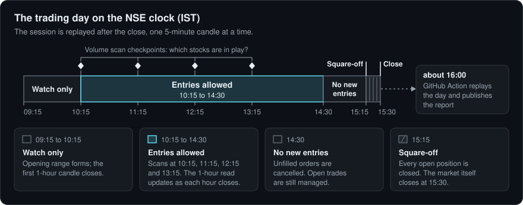
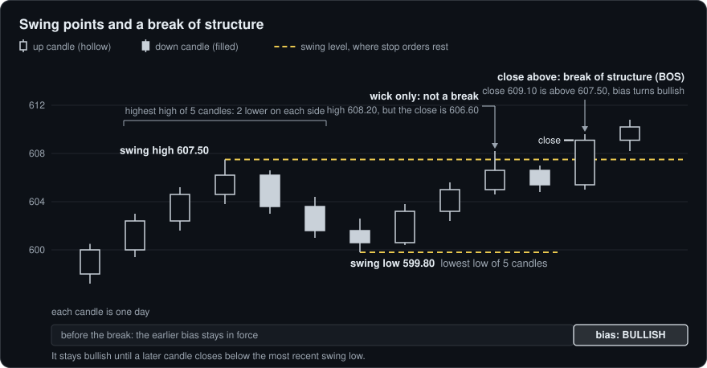
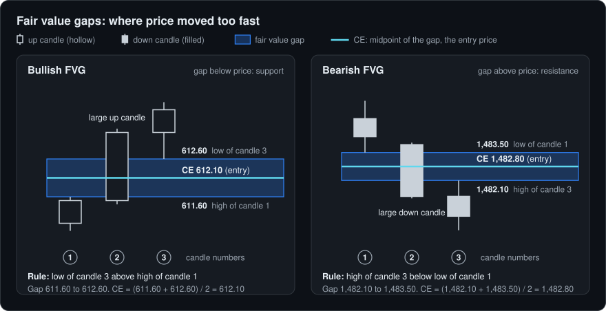
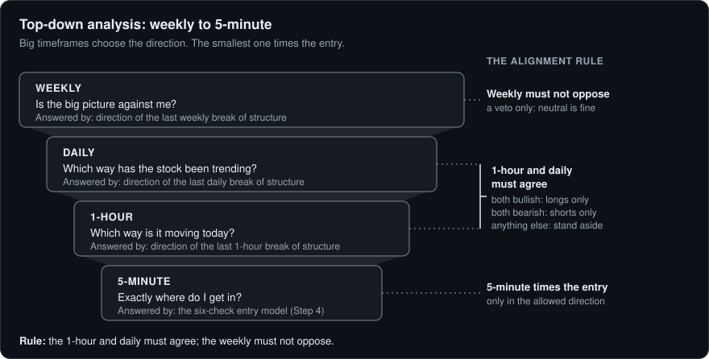
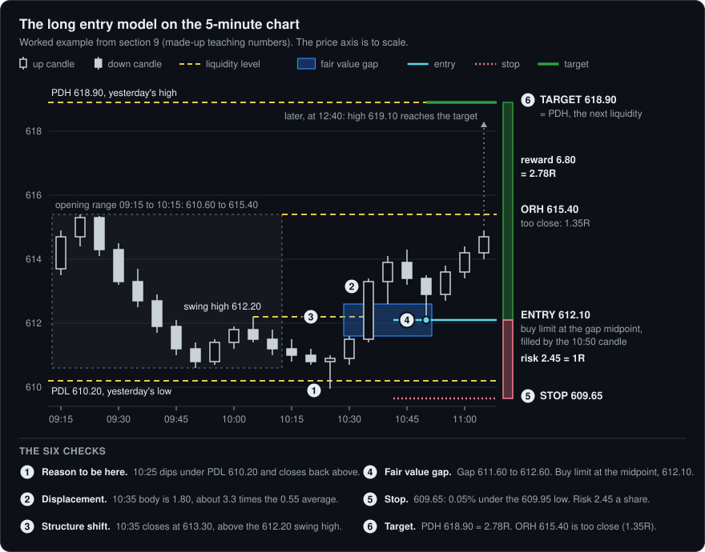
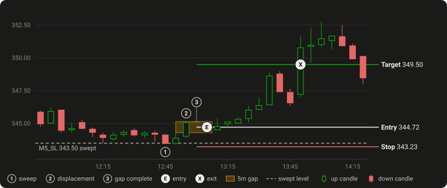
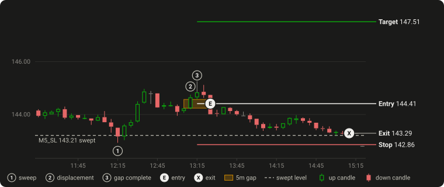

# Intraday Paper Trader: how it works

A learning guide to the `intraday_trader` module and the `intraday-trader` skill. It explains every decision the program makes, in the order it makes them, with worked numbers you can check by hand.

> This is a paper-trading simulation for education. It is not financial advice. Trade at your own risk.

## Contents

1. [What it does in one minute](#1-what-it-does-in-one-minute)
2. [The money rules](#2-the-money-rules)
3. [Three ideas you need first](#3-three-ideas-you-need-first)
4. [Step 1: find the stocks in play](#4-step-1-find-the-stocks-in-play)
5. [Step 2: read the trend top-down](#5-step-2-read-the-trend-top-down)
6. [Step 3: mark the levels and the 1-hour gaps](#6-step-3-mark-the-levels-and-the-1-hour-gaps)
7. [Step 4: the 5-minute entry](#7-step-4-the-5-minute-entry)
8. [Step 5: orders, exits and square-off](#8-step-5-orders-exits-and-square-off)
9. [Worked example: a long trade from start to finish](#9-worked-example-a-long-trade-from-start-to-finish)
10. [Worked example: a short trade that ends at square-off](#10-worked-example-a-short-trade-that-ends-at-square-off)
11. [Real trades from the replay](#11-real-trades-from-the-replay)
12. [What the simulation gets right, and what it leaves out](#12-what-the-simulation-gets-right-and-what-it-leaves-out)
13. [Running it](#13-running-it)
14. [Settings](#14-settings)
15. [Glossary](#15-glossary)

---

## 1. What it does in one minute

Every trading day, after the NSE closes, the program replays the session bar by bar and trades it on paper:

1. **Scan.** From about 210 liquid NSE stocks (the F&O list), pick the ones trading unusually high volume today. These are the stocks "in play".
2. **Bias.** For each of those, read the trend on the weekly, daily and 1-hour charts. Trade only when the 1-hour and daily agree and the weekly does not disagree.
3. **Location.** Mark where stop orders are likely resting (yesterday's high and low, the opening range, swing points) and where the 1-hour chart left a fair value gap.
4. **Entry.** On the 5-minute chart, wait for price to take out one of those levels or dip into a 1-hour gap, then turn hard in the direction of the bias and leave a 5-minute fair value gap. Place a limit order inside that gap.
5. **Manage.** Stop beyond the turn, target at the next liquidity level at least 2R away, everything closed by 15:15.

Then it updates a ₹1,00,000 paper portfolio, writes a daily HTML report and publishes it to the reports website.



| Clock (IST) | What happens |
|---|---|
| 09:15 – 10:15 | Watch only. The opening range forms and the first 1-hour candle completes. |
| 10:15 | First volume scan. Entries may begin. |
| 11:15, 12:15, 13:15 | Volume scan repeats; stocks that came alive later join the watchlist. The 1-hour read is refreshed as each hourly candle closes. |
| 14:30 | No new entries. Unfilled orders are cancelled. |
| 15:15 | Every open position is squared off. |
| about 16:00 | The GitHub Action replays the day and publishes the report. |

The replay never peeks ahead. A decision made at 11:20 uses only candles that had closed by 11:20. Section 12 explains how that is enforced.

---

## 2. The money rules

These are fixed in [`intraday_trader/config.py`](../../intraday_trader/config.py).

| Rule | Value |
|---|---|
| Starting capital | ₹1,00,000 |
| Own money per trade (margin) | at most ₹10,000 |
| Intraday leverage | 3x, so ₹10,000 controls up to ₹30,000 of stock |
| Brokerage | ₹25 flat per completed trade |
| Positions open at once | at most 5 |
| Trades per day | at most 8, and one per stock |
| Daily loss limit | no new trades once the day is down 2% of capital |

### How many shares

```
quantity = floor( 30,000 / entry price )
```

A stock at ₹612.10 gives `floor(30,000 / 612.10) = 49` shares. That is ₹29,992.90 of stock, for which ₹9,997.63 of your own money is blocked (one third).

### What a trade can win or lose

Leverage multiplies the size of the position, not the distance to your stop. Suppose the stop is ₹2.45 below entry and the target ₹6.80 above:

| | Calculation | Amount |
|---|---|---|
| Risk | 49 × 2.45 | ₹120.05 |
| Reward | 49 × 6.80 | ₹333.20 |
| If the target is hit | 333.20 − 25 | **+₹308.20** |
| If the stop is hit | −120.05 − 25 | **−₹145.05** |

Two things to notice.

**Brokerage is a real cost at this size.** ₹25 is about a fifth of the ₹120 risk. This is why the program never places a stop closer than 0.30% from entry: on ₹30,000 that is ₹90 of risk, which keeps brokerage under roughly 28% of it. A tighter stop looks attractive on a chart and loses money to charges.

**You do not need to win often when winners are bigger than losers.** With the numbers above, the break-even win rate is `145.05 / (145.05 + 308.20) = 32%`. Win more than one trade in three of this shape and the account grows. This is the reason for the 2R minimum.

### R: the unit everything is measured in

**1R is the money you lose if the stop is hit**, before charges. A trade that makes 2.5 times its risk is a "2.5R" trade. Reports show the R multiple of every trade after charges, so the long trade above is `308.20 / 120.05 = +2.57R` and its losing version is `−145.05 / 120.05 = −1.21R`.

---

## 3. Three ideas you need first

The method is ICT (Inner Circle Trader), also called Smart Money Concepts. Stripped of jargon it rests on three observations about price.

### 3.1 Liquidity: where the stop orders are

Traders who are long put their stop-loss orders just below a recent low. Traders who are short put theirs just above a recent high. So below every obvious low sits a cluster of sell orders, and above every obvious high a cluster of buy orders.

- **Sell-side liquidity (SSL)** rests below lows.
- **Buy-side liquidity (BSL)** rests above highs.

Price is drawn to these clusters because that is where large orders can be filled. A very common sequence is: price dips just under a well-known low, triggers the stops, and then reverses sharply. That dip is a **liquidity sweep** (also "stop hunt").

The program uses a sweep in two ways: a sweep *against* the trend is the place to look for an entry, and the liquidity on the *other* side is the target.

### 3.2 Market structure: which way is the trend

A **swing high** is a candle whose high is higher than the candles on both sides of it. A **swing low** is the mirror image. When a candle **closes** above the last swing high, structure has broken upward. This is a **break of structure (BOS)**. A wick that pokes above and closes back below does not count.



The program asks one question on each timeframe: **which way was the most recent break of structure?** Up means bullish, down means bearish, none means neutral.

Example on a daily chart. The high of 4 November is ₹607.50, higher than the two days before and the two days after, so it is a swing high. On 10 November the stock closes at ₹609.10. That close is above ₹607.50, so the daily structure broke upward on 10 November and the daily bias is bullish. It stays bullish until some later day closes below the most recent swing low.

On the 5-minute chart the same event has a different name: a **market structure shift (MSS)**. It is the first sign that a small down-move has turned up.

### 3.3 Fair value gap: where price moved too fast

Look at any three consecutive candles. If the **low of the third** is above the **high of the first**, the middle candle moved so fast that a band of prices was crossed in one direction only. That band is a bullish **fair value gap (FVG)**.



| | Candle 1 | Candle 2 | Candle 3 | Gap |
|---|---|---|---|---|
| Bullish FVG | high 611.60 | large up candle | low 612.60 | 611.60 to 612.60 |
| Bearish FVG | low 1,483.50 | large down candle | high 1,482.10 | 1,482.10 to 1,483.50 |

Price often comes back to such a gap before continuing, which makes it a precise place to enter with a tight stop. The midpoint of the gap is called **consequent encroachment (CE)**: for the bullish gap above, `(611.60 + 612.60) / 2 = 612.10`. That midpoint is where the program places its limit order.

A bullish gap stops being valid when a later candle **closes below its bottom**. A bearish gap stops being valid when a later candle closes above its top.

---

## 4. Step 1: find the stocks in play

A setup in a sleepy stock tends to go nowhere. The same setup in a stock that the whole market is watching today tends to follow through. So the program first looks for unusual volume.

### Relative volume (RVOL)

```
RVOL = volume traded today up to now
       ───────────────────────────────────────────────────────
       average volume traded by the same time on the last 10 sessions
```

Comparing like with like matters. Volume by 10:15 today is compared with volume by 10:15 on previous days, not with a full-day average, because the first hour always carries heavy volume.

A stock joins the watchlist when, at a checkpoint:

- RVOL is 1.5 or more,
- at least ₹5 crore has traded so far today, and
- the price is ₹50 or more,

and it is among the top 10 by RVOL at that checkpoint. Checkpoints are 10:15, 11:15, 12:15 and 13:15. The watchlist holds at most 20 names.

### Example at 10:15

| Stock | Volume by 10:15 today | 10-day average by 10:15 | RVOL | Traded value | In play? |
|---|---|---|---|---|---|
| ABC | 18,40,000 | 8,00,000 | 2.30 | ₹112.6 cr | Yes |
| DEF | 5,10,000 | 4,80,000 | 1.06 | ₹41.0 cr | No, volume is ordinary |
| GHI | 96,000 | 30,000 | 3.20 | ₹2.9 cr | No, too little money traded |

GHI shows why the traded-value floor exists: a large ratio on a tiny base is noise.

The code is in [`intraday_trader/volume.py`](../../intraday_trader/volume.py).

---

## 5. Step 2: read the trend top-down



Each timeframe answers a different question.

| Timeframe | Question | How it is answered |
|---|---|---|
| Weekly | Is the big picture against me? | Direction of the last weekly break of structure |
| Daily | Which way has the stock been trending? | Direction of the last daily break of structure |
| 1-hour | Which way is it moving today? | Direction of the last 1-hour break of structure |
| 5-minute | Exactly where do I get in? | The entry model in Step 4 |

### The alignment rule

| 1-hour | Daily | Weekly | Decision |
|---|---|---|---|
| Bullish | Bullish | Bullish or neutral | **Longs only** |
| Bearish | Bearish | Bearish or neutral | **Shorts only** |
| anything else | | | **Stand aside** |

The 1-hour and the daily must agree, because a 5-minute entry against either of them is fighting the people who move the stock. The weekly only has a veto: it does not have to agree, but it must not point the other way. When all three agree the report marks the trade "3/3 aligned".

Weekly and daily reads use candles up to yesterday. The 1-hour read is refreshed during the day each time an hourly candle closes (10:15, 11:15, and so on), so a stock that was bearish at 10:15 can become tradable on the long side at 12:15 if its 1-hour structure breaks upward.

### Example

For ABC at 10:15:

- **Weekly:** three weeks ago it closed above the ₹598.00 weekly swing high. Last break is up. Bullish.
- **Daily:** on 10 November it closed above the ₹607.50 swing high. Bullish.
- **1-hour:** yesterday afternoon an hourly candle closed above the ₹611.20 swing high. Bullish.

Result: longs only, 3/3 aligned. The program will now ignore every bearish pattern in ABC for as long as this holds.

The 1-hour candles are built from the 5-minute data and start on the NSE clock (09:15, 10:15, ...), the same as an NSE 1-hour chart on any charting platform.

---

## 6. Step 3: mark the levels and the 1-hour gaps

Before looking at the 5-minute chart the program writes down where things are likely to happen.

### Liquidity levels

| Name | What it is | Side |
|---|---|---|
| PDH / PDL | Previous day's high / low | BSL / SSL |
| PWH / PWL | Previous week's high / low | BSL / SSL |
| ORH / ORL | Opening range high / low: the extremes of 09:15 – 10:15 | BSL / SSL |
| HOD / LOD | Today's high / low so far | BSL / SSL |
| H1_SH / H1_SL | Unbroken 1-hour swing highs / lows | BSL / SSL |
| D_SH / D_SL | Unbroken daily swing highs / lows | BSL / SSL |
| M5_SH / M5_SL | Today's 5-minute swing highs / lows | BSL / SSL |

For a long trade, the lows are where a sweep may happen and the highs are the targets. For a short trade it is the other way round.

### 1-hour fair value gaps

The program also lists every 1-hour FVG from roughly the last 10 sessions that is still valid and at least 0.10% of the price wide. In an uptrend, a bullish 1-hour gap below the current price is a zone where buyers stepped in hard once and may do so again. This is the "based on the one hour chart" part of the method: the 1-hour chart says *where*, the 5-minute chart says *when*.

---

## 7. Step 4: the 5-minute entry

Every time a 5-minute candle closes, the program asks whether that candle completed a setup. A long setup needs all six checks below. A short setup is the exact mirror.



| # | Check | Rule for a long |
|---|---|---|
| 1 | **Reason to be here** | Within the last 12 candles (one hour), price either (a) traded **below a sell-side level** (PDL, PWL, ORL, a 1-hour or daily swing low, or one of today's 5-minute swing lows) that had not been broken earlier today, and is now back above it; or (b) dipped **into a valid bullish 1-hour FVG** without closing below it. |
| 2 | **Displacement** | The middle candle of the gap is an up candle whose body is at least 1.2 times the average body of the previous 20 candles. |
| 3 | **Structure shift** | After the low, some candle closed above the most recent 5-minute swing high that came before the low. |
| 4 | **Fair value gap** | The candle that just closed has its low above the high of the candle two bars earlier, and the gap is at least 0.05% of the price. |
| 5 | **Sensible stop** | Stop goes 0.05% below the lowest low of the move. If that is closer than 0.30% to entry it is moved out to 0.30%. If it would be further than 1.2%, there is no trade. |
| 6 | **Room to the target** | Target is the nearest buy-side level above entry that is at least 2R away. If the nearest such level is more than 4R away the target is pulled in to 4R. If no level sits at least 2R away, the target is a plain 2R. |

Why each check exists:

- **Check 1** stops the program from buying every green candle. A sweep means the weak sellers' stops have been taken. A tap of a 1-hour gap means price has returned to a zone where buyers previously overwhelmed sellers.
- **Checks 2 and 3** ask for proof that the turn is real. A slow drift back up is not evidence. A fast candle that closes above the previous swing high is.
- **Check 4** gives a precise entry. Buying the midpoint of the gap, rather than chasing the candle, is what keeps the stop small and the reward-to-risk large.
- **Checks 5 and 6** are arithmetic. They reject trades where brokerage would eat the edge or where there is nothing to aim at.

The report names the reason for each trade as a context tag: `SWEEP:PDL` means "swept the previous day's low", `H1_FVG` means "tapped a 1-hour fair value gap". A trade can carry both.

The code is `detect_setup` in [`intraday_trader/ict.py`](../../intraday_trader/ict.py).

---

## 8. Step 5: orders, exits and square-off

A signal becomes a **limit order** at the midpoint of the 5-minute gap. From the next candle:

| Event | Result |
|---|---|
| Price trades down to the entry price (long) | **Filled.** If the candle opens below the entry price, the fill is at the open. |
| 6 candles (30 minutes) pass without a fill | Order **expired**. Price ran away without coming back. |
| A candle opens at or below the stop | Order **invalidated**. The setup failed before it could be entered. |
| It is 14:30 | Order cancelled. Too little time left for a 2R move. |

The order rests inside the gap, so if price falls right through the gap the order is filled on the way down and the stop takes the loss. That is a normal losing trade, not a cancelled order.

Once in the trade there are exactly three ways out:

| Exit | Rule |
|---|---|
| **STOP** | A candle's low reaches the stop. Exit at the stop, or at the candle's open if it gapped below. |
| **TARGET** | A candle's high reaches the target. |
| **EOD** | Still open at 15:15: exit at the last price before 15:15. |

When information is missing, the simulation assumes the worse outcome:

- A candle that touches **both** the stop and the target counts as a **stop**. A 5-minute candle does not say which came first.
- On the candle where the order fills, only the stop is checked. The target cannot be credited on that candle.

There is no trailing stop and no partial exit. One entry, one stop, one target. That keeps every result easy to verify by hand.

At the moment of fill the program also checks the account: fewer than 5 positions open, fewer than 8 trades today, the day's loss limit not hit, and free margin available. A signal that would have filled but was refused appears in the report under "Signals not traded" with the reason.

---

## 9. Worked example: a long trade from start to finish

The numbers below are **made up for teaching**. They are internally consistent so you can check every line. Section 11 shows trades the program really took.

Stock: ABC, a hypothetical NSE stock near ₹612.

**Yesterday.** High ₹618.90 (PDH), low ₹610.20 (PDL).

**10:15, Step 1.** ABC has traded 18.4 lakh shares against a usual 8.0 lakh by this time. RVOL 2.30, traded value ₹112.6 crore. It joins the watchlist.

**10:15, Step 2.** Weekly bullish, daily bullish, 1-hour bullish. Longs only, 3/3 aligned.

**10:15, Step 3.** Levels: PDL 610.20 and opening range low 610.60 below; opening range high 615.40 and PDH 618.90 above.

**10:25 to 10:45, Step 4.** The 5-minute candles:

| Candle | Open | High | Low | Close | What it means |
|---|---|---|---|---|---|
| 10:25 | 610.80 | 611.00 | **609.95** | 610.90 | Dips below PDL 610.20 and closes back above it. **The sweep.** |
| 10:30 | 610.90 | **611.60** | 610.70 | 611.50 | Candle 1 of the gap. |
| 10:35 | 611.50 | 613.40 | 611.40 | 613.30 | Body 1.80 against an average of 0.55. **Displacement.** Closes above the 612.20 swing high from 10:05. **Structure shift.** |
| 10:40 | 613.30 | 614.10 | **612.60** | 613.90 | Low 612.60 is above the 10:30 high 611.60. **Fair value gap 611.60 – 612.60.** |

The checks, one by one:

1. Reason: PDL 610.20 swept at 10:25, price now above it. Context `SWEEP:PDL`.
2. Displacement: 1.80 is 3.3 times the average body. Pass.
3. Structure shift: 613.30 closed above 612.20. Pass.
4. Gap: 1.00 wide, which is 0.16% of the price. Pass.
5. Stop: lowest low is 609.95. Less 0.05% gives **609.65**. Distance from entry is 2.45, or 0.40%. Between 0.30% and 1.2%. Pass.
6. Target: opening range high 615.40 is only 3.30 away, which is 1.35R. Too close. PDH 618.90 is 6.80 away, which is 2.78R. **Target 618.90.**

**The order.** Buy limit at the gap midpoint, **612.10**. Quantity `floor(30,000 / 612.10) = 49`.

| | |
|---|---|
| Entry | 612.10 |
| Stop | 609.65 |
| Target | 618.90 (PDH) |
| Quantity | 49 |
| Position value | ₹29,992.90 |
| Margin blocked | ₹9,997.63 |
| Risk | ₹120.05 |
| Planned reward-to-risk | 2.78 |

**10:50, the fill.** The 10:50 candle trades down to 612.00. The limit at 612.10 is filled.

**12:40, the exit.** A candle's high reaches 619.10. The target at 618.90 is hit.

| | |
|---|---|
| Gross profit | 49 × (618.90 − 612.10) = ₹333.20 |
| Brokerage | ₹25.00 |
| **Net profit** | **₹308.20** |
| R multiple | 308.20 / 120.05 = **+2.57R** |

**If it had failed instead.** Had price fallen to 609.65 first, the loss would be 49 × 2.45 + 25 = ₹145.05, or −1.21R.

---

## 10. Worked example: a short trade that ends at square-off

Also **made-up numbers**, this time showing the other context and the third kind of exit.

Stock: XYZ near ₹1,483. Weekly neutral, daily bearish, 1-hour bearish. Shorts only, 2/3 aligned.

A bearish 1-hour FVG from yesterday sits at 1,486.00 – 1,489.50. Below the market: today's low 1,476.00 and PDL 1,468.40.

| Candle | High | Low | What it means |
|---|---|---|---|
| 11:20 | **1,487.20** | 1,484.90 | Rallies into the 1-hour gap and does not close above it. **The tap.** Context `H1_FVG`. |
| 11:25 | 1,486.10 | **1,483.50** | Candle 1 of the gap. |
| 11:30 | 1,484.00 | 1,481.20 | Large down candle. Displacement and structure shift. |
| 11:35 | **1,482.10** | 1,479.60 | High 1,482.10 is below the 11:25 low 1,483.50. **Bearish gap 1,482.10 – 1,483.50.** |

- Entry: sell limit at the midpoint, **1,482.80**.
- Stop: highest high 1,487.20 plus 0.05% = **1,487.94**. Risk 5.14 per share (0.35%).
- Target: today's low 1,476.00 is 1.32R away, too close. PDL **1,468.40** is 14.40 away, which is 2.80R.
- Quantity: `floor(30,000 / 1,482.80) = 20`. Risk 20 × 5.14 = ₹102.80.

The order fills, price drifts lower all afternoon but never reaches 1,468.40. At 15:15 it is at 1,474.30 and the position is squared off.

| | |
|---|---|
| Gross profit | 20 × (1,482.80 − 1,474.30) = ₹170.00 |
| Brokerage | ₹25.00 |
| **Net profit** | **₹145.00** |
| R multiple | 145.00 / 102.80 = **+1.41R** |
| Exit reason | EOD |

An intraday trade does not get tomorrow. Many trades end like this one, between the stop and the target, which is why entries stop at 14:30.

---

## 11. Real trades from the replay

Sections 9 and 10 used made-up numbers. This section shows what the program really did on **Friday 13 November 2026**, replayed on Yahoo Finance data with:

```bash
python -m intraday_trader run --date 2026-11-13 --dry-run
```

Every number below is copied from the file that run wrote, `data/reports/INTRADAY-DAILY-2026-11-13-DRYRUN.json`. The numbered lines in each story are the program's own sentences, quoted exactly. The charts are drawn by the same code as the daily report. Up candles are hollow and green, down candles filled and red.

**The day in brief.** 213 stocks in the universe, 212 with usable data. 14 stocks made the watchlist: 10 at the 10:15 scan, 2 more at 11:15, 1 at 12:15 and 1 at 13:15. Ten of the 14 were never traded because their weekly, daily and 1-hour reads did not line up (`NOT_ALIGNED`), and one lined up but never formed a setup (`NO_SETUP`). That left 3 signals and 2 trades, for a net result of **+₹134.02**. Most of the filtering is done by the alignment rule, not by the entry checks.

### 11.1 ANGELONE: a long that reached its target

**Step 1.** Angel One was 9th on the 10:15 scan: RVOL 2.98, traded value ₹147.19 crore.

**Step 2.** The three reads at the moment of the signal, as the program wrote them:

| Timeframe | Bias | Reason |
|---|---|---|
| Weekly | BULL | Closed above the 321.90 swing high in the week ending 2026-11-06; last break of structure is up. |
| Daily | BULL | Closed above the 296.05 swing high on 2026-11-03; last break of structure is up. |
| 1-hour | BULL | Closed above the 344.30 swing high in the 2026-11-13 09:15 candle; last break of structure is up. |

Result: "1h and daily bullish, weekly bullish: longs only (3/3 aligned)."

**Steps 3 and 4.** The 5-minute candles from the sweep to the fill:

| Candle | Open | High | Low | Close | What it means |
|---|---|---|---|---|---|
| 12:45 | 344.15 | 344.20 | **343.45** | 343.45 | Trades under the 343.50 swing low from 12:15. **The sweep.** |
| 12:50 | 343.45 | **344.30** | **343.40** | 343.90 | Closes back above 343.50. Its low is the lowest of the move. Candle 1 of the gap. |
| 12:55 | 344.00 | 345.15 | 343.90 | 345.10 | Body 2.6 times the recent average. **Displacement.** Closes above the 344.65 swing high. **Structure shift.** |
| 13:00 | 345.15 | 345.70 | **345.15** | 345.15 | Low 345.15 is above the 12:50 high 344.30. **Fair value gap 344.30 to 345.15.** |
| 13:05 | 345.15 | 345.25 | 344.50 | 344.50 | Trades down through 344.72. **The fill.** |

The program's story:

> 1. 12:45 price dipped to 343.45, below an earlier 5-minute swing low today at 343.50; by 12:50 it had closed back above it.
> 2. 12:55 a strong up candle (body 2.6x the recent average) closed above the 344.65 swing high.
> 3. 13:00 left a fair value gap between 344.30 and 345.15.
> 4. Buy limit at the gap midpoint 344.72, stop 343.23 (0.05% under the 343.40 low), risk 1.49 per share.
> 5. Target 349.50, a daily swing high, 3.21 times the risk.
> 6. Limit order filled at 344.72 on the 13:05 candle: 87 shares, 29,990.64 of stock on 9,996.88 margin.
> 7. Target 349.50 was reached on the 13:50 candle; exit at 349.50.
> 8. Result: +415.86 gross, 25.00 brokerage, +390.86 net.



| | |
|---|---|
| Context | `SWEEP:M5_SL` (a 5-minute swing low from earlier today) |
| Entry | 344.72 at 13:05 |
| Stop | 343.23 |
| Target | 349.50 (`D_SH`, a daily swing high) |
| Quantity | 87 |
| Position value | ₹29,990.64 |
| Margin blocked | ₹9,996.88 |
| Risk | ₹129.63 |
| Planned reward-to-risk | 3.21 |
| Exit | 349.50 at 13:50, `TARGET` |
| Gross profit | ₹415.86 |
| Brokerage | ₹25.00 |
| **Net profit** | **₹390.86** |
| R multiple | **+3.02R** |

What to notice:

- The level that was swept is the smallest kind there is, a swing low on today's 5-minute chart. It still counts, because it was the first trade through that low today.
- The stop is not under the sweep candle. It is under the lowest low of the whole move from the sweep to the signal, which was 343.40 on the next candle.
- The target is the nearest buy-side level at least 2R above the entry. Here that was a daily swing high, 349.50, at 3.21R, inside the 4R cap, so it was used as it stood.

### 11.2 PNB: a long that was squared off at a loss

**Step 1.** Punjab National Bank joined the watchlist only at the **13:15** scan: rank 10, RVOL 2.22, traded value ₹617.79 crore.

**Step 2.**

| Timeframe | Bias | Reason |
|---|---|---|
| Weekly | BULL | Closed above the 125.22 swing high in the week ending 2026-11-06; last break of structure is up. |
| Daily | BULL | Closed above the 125.09 swing high on 2026-11-05; last break of structure is up. |
| 1-hour | BULL | Closed above the 143.79 swing high in the 2026-11-13 10:15 candle; last break of structure is up. |

Result: "1h and daily bullish, weekly bullish: longs only (3/3 aligned)."

**Steps 3 and 4.** The candles that mattered:

| Candle | Open | High | Low | Close | What it means |
|---|---|---|---|---|---|
| 12:15 | 143.50 | 143.50 | **142.93** | 143.17 | Trades under the 143.21 swing low from 10:40. **The sweep.** |
| 12:20 | 143.17 | 143.64 | 143.03 | 143.58 | Closes back above 143.21. |
| 12:30 | 143.74 | 144.50 | 143.70 | 144.40 | Closes above the 144.13 swing high. **Structure shift.** |
| 13:05 | 144.13 | **144.24** | 144.06 | 144.23 | Candle 1 of the gap. |
| 13:10 | 144.24 | 144.75 | 144.20 | 144.65 | Body 2.0 times the recent average. **Displacement.** |
| 13:15 | 144.65 | 144.85 | **144.57** | 144.84 | Low 144.57 is above the 13:05 high 144.24. **Fair value gap 144.24 to 144.57.** |
| 13:20 | 144.86 | 145.12 | 144.63 | 144.74 | Does not reach the limit. |
| 13:25 | 144.74 | 144.75 | 144.01 | 144.01 | Trades down through 144.41. **The fill.** |

The program's story:

> 1. 12:15 price dipped to 142.93, below an earlier 5-minute swing low today at 143.21; by 12:20 it had closed back above it.
> 2. 12:30 a candle closed above the 144.13 swing high, turning the 5-minute structure up.
> 3. 13:10 a strong up candle (body 2.0x the recent average) showed buyers in control.
> 4. 13:15 left a fair value gap between 144.24 and 144.57.
> 5. Buy limit at the gap midpoint 144.41, stop 142.86 (0.05% under the 142.93 low), risk 1.55 per share.
> 6. Target 147.51, a plain 2 times the risk, because no liquidity level sits at least 2 times the risk above the entry.
> 7. Limit order filled at 144.41 on the 13:25 candle: 207 shares, 29,892.87 of stock on 9,964.29 margin.
> 8. Still open at square-off; closed at 143.29, the close of the 15:10 candle.
> 9. Result: -231.84 gross, 25.00 brokerage, -256.84 net.



| | |
|---|---|
| Context | `SWEEP:M5_SL` |
| Entry | 144.41 at 13:25 |
| Stop | 142.86 |
| Target | 147.51 (`FIXED_2R`) |
| Quantity | 207 |
| Position value | ₹29,892.87 |
| Margin blocked | ₹9,964.29 |
| Risk | ₹320.85 |
| Planned reward-to-risk | 2.00 |
| Exit | 143.29 at 15:10, `EOD` |
| Gross profit | −₹231.84 |
| Brokerage | ₹25.00 |
| **Net profit** | **−₹256.84** |
| R multiple | **−0.80R** |

What to notice:

- The structure shift (12:30) and the displacement candle (13:10) are different candles, 40 minutes apart. Check 3 only needs some close above the swing high after the low; check 2 is about the middle candle of the gap. Section 9's example had both on one candle, but they do not have to be.
- PNB was not on the watchlist when the sweep happened. It joined at 13:15, and check 1 looks back 12 candles, so the 12:15 sweep still counted. The signal candle itself started at 13:15, not before.
- Both trades used about ₹30,000 of stock, but PNB's stop was 1.55 below a 144.41 entry (about 1.07%) against ANGELONE's 1.49 below 344.72 (about 0.43%). Same position size, wider stop, so ₹320.85 at risk instead of ₹129.63.
- Before the square-off, price reached neither the stop nor the target. The 15:15 square-off closed it at −0.80R, a smaller loss than a full stop-out. ANGELONE and PNB were open at the same time between 13:25 and 13:50, each with its own ₹10,000 of margin.

### 11.3 PAGEIND: a valid signal that could not be traded

**Step 1.** Page Industries topped the 10:15 scan with an RVOL of **33.6**: by 10:15 it had traded 33.6 times its usual volume for that time of day. Traded value ₹253.9 crore.

**Step 2.**

| Timeframe | Bias | Reason |
|---|---|---|
| Weekly | BEAR | Closed below the 33,155.00 swing low in the week ending 2026-11-13; last break of structure is down. |
| Daily | BEAR | Closed below the 34,715.00 swing low on 2026-11-12; last break of structure is down. |
| 1-hour | BEAR | Closed below the 36,035.00 swing low in the 2026-11-12 14:15 candle; last break of structure is down. |

Result: "1h and daily bearish, weekly bearish: shorts only (3/3 aligned)."

"The week ending 2026-11-13" is the replayed day's own week. That weekly candle is built only from the days before the session, Monday 9 to Thursday 12 November here, so the read does not see Friday.

**Step 4.** The program's story:

> 1. 11:45 price pushed up to 31,825.00, above an earlier 5-minute swing high today at 31,815.00, and closed back below it.
> 2. 12:15 a strong down candle (body 2.1x the recent average) closed below the 31,655.00 swing low.
> 3. 12:20 left a fair value gap between 31,720.00 and 31,745.00.
> 4. Sell limit at the gap midpoint 31,732.50, stop 31,840.91 (0.05% above the 31,825.00 high), risk 108.41 per share.
> 5. Target 31,405.00, a 1-hour swing low, 3.02 times the risk.

The setup passed all six checks. The sell limit at 31,732.50 was reached on the **12:50** candle, and at that moment the program checked the account and refused the trade:

| | |
|---|---|
| Status | `SKIPPED` |
| Reason | share price above the per-trade limit |
| Decided on | the 12:50 candle |

The money rule allows ₹10,000 of margin at 3x, so at most ₹30,000 of stock per trade. One PAGEIND share cost ₹31,732.50, so even a single share was over the limit and the quantity came out as zero. The report lists it under "Signals not traded" so you can see the rule at work. The program does not record what the trade would have done, and neither does this guide.

### 11.4 The 45-session backtest

```bash
python -m intraday_trader backtest --days 45
```

Run on 16 November 2026. The market was open at the time, so the program left out that day's unfinished session and replayed the 45 complete sessions before it. Each session starts from the previous one's closing capital, and the live portfolio file is never touched. The figures come from `data/reports/INTRADAY-BACKTEST-2026-11-16.json`.

| | |
|---|---|
| Sessions | 45, from 2026-09-08 to 2026-11-13 |
| Trades | 39 |
| Wins / losses | 17 / 22 |
| Win rate | 43.6% |
| Gross profit | ₹1,950.99 |
| Brokerage | ₹975.00 |
| **Net profit** | **₹975.99 (+0.98%)** |
| Average win / average loss | ₹248.12 / −₹147.36 |
| Profit factor | 1.3 |
| Expectancy | ₹25.03 per trade, 0.17R on average |
| Maximum drawdown (end-of-day capital) | ₹1,298.64 (1.29%) |
| Best day / worst day | 2026-09-16, +₹696.97 / 2026-11-11, −₹461.72 |

The last session of the backtest is the same 13 November replayed above, and it produced the same two trades and the same +₹134.02.

**Read this with care.** 39 trades is far too few to prove that the method has an edge; a handful of trades going the other way would turn the result negative. Brokerage took half of the gross profit. If your broker charges ₹25 per order rather than per trade, a round trip costs ₹50, which on these 39 trades is ₹1,950.00 and would leave almost nothing. Yahoo keeps only 60 days of 5-minute candles, so a backtest run on another day replays a different window and will give different numbers.

---

## 12. What the simulation gets right, and what it leaves out

### No lookahead

A backtest is worthless if it uses information from the future, even by accident. This one is built so that it cannot:

- The engine walks the day one 5-minute candle at a time. At each candle it hands the analysis functions a table that **ends at that candle**. A function cannot read a row it was never given.
- 1-hour candles are rebuilt from the 5-minute data at each step and an hourly candle is used only after it has completed.
- Weekly and daily analysis uses candles up to yesterday.
- The volume scan at 10:15 counts only volume traded before 10:15.
- An automated test replays a day twice, once with the full data and once with everything after that day removed, and requires identical results.
- Another test replays each day again, stopped right after every candle on which something happened (a signal, a fill, an expiry, an exit). Everything up to that candle must come out the same, to the paisa. A rule that peeked even one candle ahead would fail it.

### Pessimistic where it has to guess

- Stop and target in the same candle counts as a stop.
- The target is never credited on the candle of entry.
- A gap through the stop is filled at the worse price.
- When one stock's trade closes and another stock's order is touched in the same candle, the candle cannot say which came first. So the close does not help the new order: the position slot, the margin and any profit it frees count only from the next candle. A loss counts at once, so it can stop the new order under the daily loss limit.
- If Yahoo's 5-minute data for a stock stops early, an open trade is closed at the last price available. When the data stops before 15:00, the report says so in its notes rather than calling it a normal square-off.

### What it leaves out

Read a profitable replay with these in mind.

| Left out | Effect on real results |
|---|---|
| **Statutory charges.** Only the flat ₹25 is deducted. Real trades also pay STT, exchange fees, GST and stamp duty, roughly ₹15 – ₹20 more on a ₹30,000 round trip. | Real profit is lower. Set `CHARGE_PER_TRADE` to 45 to approximate it. |
| **Brokerage per order.** Most Indian brokers charge per executed order, so a round trip is two charges. | If your broker charges ₹25 per order, set `CHARGE_PER_TRADE` to 50. |
| **Slippage.** Stops are filled at the stop price. | A real stop-market order usually fills a little worse. |
| **Queue position.** A limit order is treated as filled when price touches it. | In a real order book a touch does not guarantee a fill. |
| **Leverage availability.** 3x is assumed for every stock. | Brokers set intraday margin per stock and change it on volatile days. |
| **Data quality.** Yahoo Finance 5-minute candles can be delayed, revised or missing a bar. | Occasional trades differ from what a broker feed would show. |
| **Today's universe.** The stock list is the current F&O list. | Negligible for a 60-day replay, but worth knowing. |
| **Short-selling limits.** Shorting is assumed possible in every stock. | Stocks in a ban period or at a circuit limit cannot be shorted. |

### It is a replay, not a live bot

The GitHub Action runs once after the close. It does not place orders and it does not watch the market live. GitHub's scheduler can start a job many minutes late, which is harmless for an end-of-day replay and useless for 5-minute entries. The value is in the daily record: the same rules applied the same way every day, so you can see what they are worth.

---

## 13. Running it

### On your machine

```bash
pip install -r requirements.txt

# Replay the latest session, update the paper portfolio, write the report
python -m intraday_trader run

# Replay a past session without touching the portfolio
python -m intraday_trader run --date 2026-11-13 --dry-run

# Replay the last 30 sessions with a fresh ₹1,00,000
python -m intraday_trader backtest --days 30

# Tests
python -m unittest discover -s tests -p "test_intraday_*.py"
```

Yahoo Finance keeps about 60 days of 5-minute candles, and a session needs at least 5 earlier sessions as its volume baseline, so a backtest can cover roughly 50 sessions. On 16 November 2026 the limit was 54.

What gets written:

| File | Contents |
|---|---|
| `data/intraday_portfolio.json` | Capital, one summary row per session, every trade. Committed to `main`. |
| `data/reports/INTRADAY-DAILY-YYYY-MM-DD.html` | The daily report. Published to the website, not committed to `main`. |
| `data/reports/INTRADAY-DAILY-YYYY-MM-DD.json` | The same day as data, including the candles behind each chart. |
| `data/reports/INTRADAY-BACKTEST-YYYY-MM-DD.html` | Backtest report. |

Running the same date twice replaces that day's result. It never double counts.

Run it after the close. A run made while the market is still open replays only the candles so far, records the day as **partial** (the report shows a banner and a note), and the next run after 15:30 replaces it. A backtest started during market hours leaves today out.

### On GitHub Actions

The workflow is [`.github/workflows/intraday-trader.yml`](../../.github/workflows/intraday-trader.yml).

- **Scheduled:** Monday to Friday at 16:00 IST. On a market holiday it finds no new session and exits without changing anything.
- **Manual:** Actions → *Intraday Trader* → *Run workflow*. Choose `daily` or `backtest`, optionally a date, the number of backtest days, and whether it is a dry run.

Each run commits `data/intraday_portfolio.json` to `main` and pushes the HTML report to the `reports` branch, which GitHub Pages serves. The home page of the site lists the intraday daily reports and the swing weekly reports together.

### As a skill in Claude Code

The skill lives in [`.claude/skills/intraday-trader/`](../../.claude/skills/intraday-trader/SKILL.md). Ask in plain words:

- "run the intraday paper trader"
- "explain today's intraday trades"
- "backtest the intraday strategy for 30 days"
- "why did it skip RELIANCE today?"

Claude runs the module, reads the result and explains each trade using the concepts in this guide. It reports only numbers the program produced.

---

## 14. Settings

All in [`intraday_trader/config.py`](../../intraday_trader/config.py).

| Setting | Default | Meaning |
|---|---|---|
| `INITIAL_CAPITAL` | 100000 | Starting paper capital |
| `MAX_MARGIN_PER_TRADE` | 10000 | Own money per trade |
| `LEVERAGE` | 3.0 | Position value = margin × leverage |
| `CHARGE_PER_TRADE` | 25 | Flat brokerage per completed trade |
| `MAX_OPEN_POSITIONS` | 5 | Positions open at once |
| `MAX_TRADES_PER_DAY` | 8 | New trades per session |
| `DAILY_LOSS_LIMIT_PCT` | 0.02 | Stop opening trades after this loss |
| `MIN_RVOL` | 1.5 | Relative volume needed to be in play |
| `MIN_TURNOVER_CR` | 5.0 | Minimum traded value so far today, ₹ crore |
| `SCAN_CHECKPOINTS` | 10:15, 11:15, 12:15, 13:15 | When the volume scan runs |
| `ENTRY_START` / `ENTRY_END` | 10:15 / 14:30 | Entry window |
| `SQUARE_OFF` | 15:15 | Forced exit |
| `CONTEXT_LOOKBACK_BARS` | 12 | How recent the sweep or tap must be |
| `DISPLACEMENT_BODY_MULT` | 1.2 | How large the displacement candle must be |
| `ENTRY_AT` | `ce` | `ce` = gap midpoint, `edge` = nearest edge of the gap |
| `ORDER_TTL_BARS` | 6 | Candles a limit order stays alive |
| `MIN_STOP_PCT` / `MAX_STOP_PCT` | 0.30% / 1.2% | Allowed stop distance |
| `MIN_RR` / `MAX_RR` | 2.0 / 4.0 | Reward-to-risk floor and cap |
| `ALLOW_SHORT` | True | Set False for longs only |

Change one thing at a time and run a backtest before and after. Tuning several settings until the last 40 days look good produces a strategy fitted to those 40 days, not a better one.

---

## 15. Glossary

| Term | Meaning |
|---|---|
| **BOS** | Break of structure. A candle closes beyond the last swing high or low. |
| **BSL / SSL** | Buy-side / sell-side liquidity. Stop orders resting above highs / below lows. |
| **CE** | Consequent encroachment. The midpoint of a fair value gap. |
| **Displacement** | An unusually large candle showing one side in control. |
| **FVG** | Fair value gap. Three candles where the first and third do not overlap. |
| **In play** | A stock trading far more volume than usual today. |
| **Leverage** | Borrowed buying power. 3x means ₹10,000 controls ₹30,000. |
| **Margin** | Your own money blocked for a trade. |
| **MSS** | Market structure shift. A break of structure on the entry timeframe, signalling a turn. |
| **ORH / ORL** | Opening range high / low, here the first hour. |
| **PDH / PDL** | Previous day's high / low. |
| **PWH / PWL** | Previous week's high / low. |
| **R** | The amount risked on a trade. Profit and loss are quoted in multiples of it. |
| **RR** | Reward-to-risk ratio: distance to target divided by distance to stop. |
| **RVOL** | Relative volume. Today's volume divided by the usual volume by the same time. |
| **Square-off** | Closing every intraday position before the market closes. |
| **Sweep** | Price trades just beyond a level, triggers the stops there and comes back. |
| **Swing high / low** | A candle whose high / low stands out from its neighbours on both sides. |

---

*This is an educational analysis, not financial advice. Trade at your own risk.*
